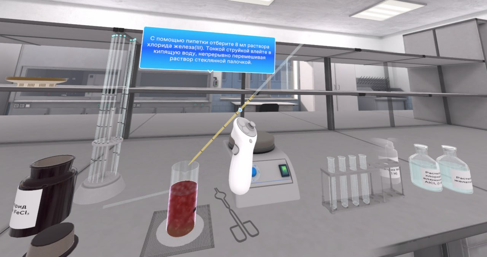
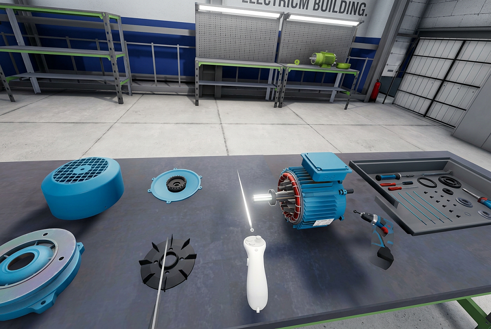
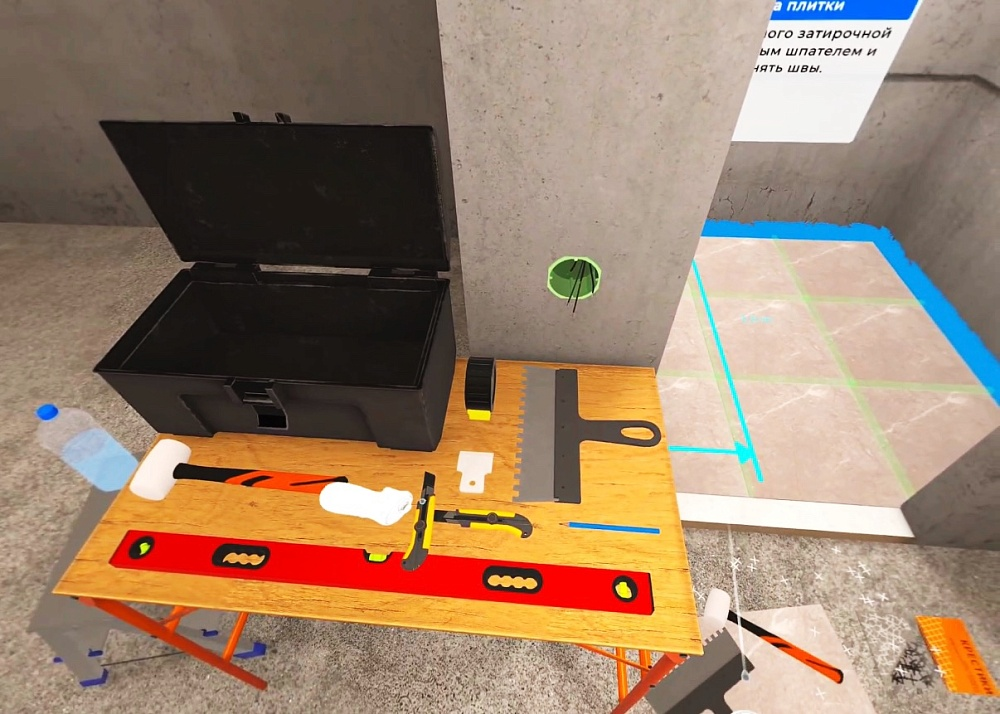

# Unity Developer | Gameplay • VR/XR • PC • Mobile

Привет! Я Ольга, Unity/C# разработчик с коммерческим опытом создания интерактивных 3D-приложений и обучающих VR/PC-симуляторов.

Разрабатываю игровые механики и переиспользуемые системы взаимодействия: от логики и физических взаимодействий до интерфейсов, визуальных эффектов и сборок.

Основной фокус — gameplay programming, системы взаимодействия, поведение объектов и пошаговые сценарии. Также самостоятельно разрабатываю игровые проекты.

  <b>Технологии:</b>
  <code>Unity</code>
  <code>C#</code>
  <code>XR Interaction Toolkit</code>
  <code>UI Toolkit</code>
  <code>uGUI</code>
  <code>URP</code>
  <code>Timeline</code>
  <code>Zenject</code>
  <code>Git</code>

  <b>Платформы:</b>
  <code>PC</code>
  <code>Meta Quest</code>
  <code>Android VR</code>
  <code>WebGL</code>

## Коммерческие проекты
_Компания «Диджитех». Образовательные и производственные симуляторы на Unity для PC и VR._

<table>
  <tr>
    <td width="220" valign="top">
      
    </td>
    <td valign="top">
      <h3>VR Chemistry Laboratory</h3>
      

        <strong>Unity · C# · XR Interaction Toolkit · Physics · UI</strong>
      

      

        Разработка систем переливания и смешивания веществ,
        химических реакций и взаимодействия с лабораторными
        инструментами. Реализация VR-системы отчётности 
        с вводом химических формул, уравнений реакций 
        и результатов опытов.
      

      <a href="https://digi-tech.dev/catalog/obshcheprofessionalnye-distsiplinyy/khimiya/programmnyy-kompleks-laboratoriya-po-khimii/">
        Страница проекта ↗
      </a>
    </td>
  </tr>
  <tr>
    <td width="220" valign="top">
      
    </td>
    <td valign="top">
      <h3>Industrial & Engineering Simulators</h3>
      

        <strong>Unity · C# · XR Interaction Toolkit · Timeline</strong>
      

      

        Разработка интерактивных сценариев сборки и разборки
        оборудования с проверкой действий пользователя,
        а также анимаций производственных и технологических 
        процессов.
      

      

  <strong>Проекты:</strong>
  <a href="https://digi-tech.dev/catalog/mashinostroenie-i-mekhanoobrabotka/dvigateli-i-elektrooborudovanie/programmnyy-kompleks-remont-i-defektovka-elektrodvigateley/">Электродвигатели</a>
  ·
  <a href="https://digi-tech.dev/catalog/metallurgiya/tsvetnaya-metallurgiya%D1%83/programmnyy-kompleks-proizvodstvo-alyuminiya/">Производство алюминия</a>

    </td>
  </tr>
  <tr>
    <td width="220" valign="top">
      
    </td>
    <td valign="top">
      <h3>Construction Simulators</h3>
      

        <strong>Unity · C# · XR Interaction Toolkit · Physics</strong>
      

      

        Строительные инструменты, поверхности, 
        материалы и сценарии монтажных работ.
      

      

  <strong>Проекты:</strong>
  <a href="https://digi-tech.dev/catalog/stroitelnye-tekhnologii/otdelochnye-raboty/programmnyy-kompleks-tekhnologiya-oblitsovki-keramicheskoy-plitkoy/?utm_source=chatgpt.com">Плитка</a>
  ·
  <a href="https://digi-tech.dev/catalog/stroitelnye-tekhnologii/otdelochnye-raboty/programmnyy-kompleks-malyarnye-i-dekorativnye-raboty/?utm_source=chatgpt.com">Маляр</a>
  ·
  <a href="https://digi-tech.dev/catalog/stroitelnye-tekhnologii/tekhnologiya-stroitelnogo-proizvodstva/virtualnyy-kompleks-s-sistemoy-virtualnoy-realnosti-montazh-zhelezobetonnykh-konstruktsiy-97-serii/?utm_source=chatgpt.com">ЖБК</a>
  ·
  <a href="https://digi-tech.dev/catalog/stroitelnye-tekhnologii/sistemy-zhkkh/virtualnyy-kompleks-obsluzhivanie-i-ekspluatatsiya-mnogokvartirnogo-zhilogo-doma/?utm_source=chatgpt.com">Обслуживание МКД</a>
  ·
  <a href="https://digi-tech.dev/catalog/stroitelnye-tekhnologii/tekhnologiya-stroitelnogo-proizvodstva/programmnyy-kompleks-opalubochnye-i-armaturnye-raboty/?utm_source=chatgpt.com">Опалубка</a>

    </td>
  </tr>
</table>

## 🔥 Играбельные проекты

### [Колоброд](https://yandex.com/games/app/430135?draft=true&lang=ru)
**Жанр:** RPG кликер   
**Описание:** Небольшая игра, вдохновленная русскими сказками и славянской тематикой    
**Подробнее о проекте:** Игра, разрабатываемая в рамках курса, куда я пошла, чтобы заставить себя работать над пет проектами.  
**Код:** [GitHub-репозиторий](https://github.com/DragSver/ClickerBattler)  
**Подробнее:** [О проекте](https://github.com/DragSver/Unity-Portfolio/blob/main/Pet-Projects/%D0%9A%D0%BE%D0%BB%D0%BE%D0%B1%D1%80%D0%BE%D0%B4.md)

📬 **Связаться со мной:** [GitHub](https://github.com/DragSver) | [Telegram](https://t.me/seemtobewell)
